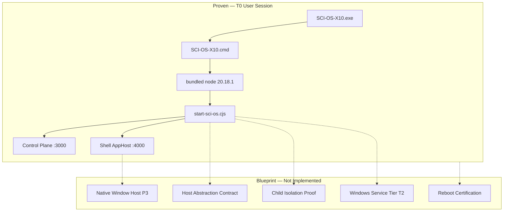

# SCI OS ×10 — Windows Host Blueprint (Current Baseline Audit)

**Phase:** BLUEPRINT AUDIT ONLY — no implementation authorized  
**Label:** ALPHA_NON_PRODUCTION  
**At:** 2026-08-18  
**Baseline:** `8a0125a1` → `pkg_1787074480539` → P0=0  

Runtime is **intentionally stopped** after package-sync proof. Stopped runtime is **not** failure.

---

## Executive summary

SCI OS ×10 has a **proven first-release Windows entry stack**: LOCALAPPDATA install, bundled Node 20.18.1, thin EXE → CMD → `start-sci-os.cjs`, Control Plane :3000 + Shell AppHost :4000, atomic install with rollback, and a **PASS** P0 golden path on build `pkg_1787074480539`.

What does **not** exist yet is a **unified Windows Host Blueprint** as a protected contract. Host behavior is implemented as **fragments** (resolve-app-root, packaged-mode, resolve-node-runtime, runtime-services, process-supervisor, atomic-install) without a formal host-abstraction spec, without Windows Services/NSSM, without host reboot certification, and without host-level capability mining separate from product meta-recovery.

**AppHost ≠ Windows Host.** Architectural decision ADR-SHELL-001 locks the HTTP Shell (cockpit-ui) as the product AppHost. The Windows host layer is **launcher + runtime isolation + lifecycle** only.

---

## Protected baseline (do not regress)

```
SOURCE    8a0125a1
    ↓
PACKAGE   pkg_1787074480539
    ↓
INSTALL   pkg_1787074480539
    ↓
RUNTIME   pkg_1787074480539
```

| Invariant | Value |
|-----------|-------|
| P0 | **0** (protected) |
| P1/P2/P3 | 91 / 184 / 46 |
| Bundled Node | 20.18.1 |
| Active install | `%LOCALAPPDATA%\SCI OS X10\app` |
| Entry | `SCI-OS-X10.exe` |
| Previous valid | `pkg_1786656680759` → `app.backup.last` |

---

## 1 — Windows capability mining

**Method:** Inventory Windows mechanisms vs SCI evidence on current install. No new runtime probes during blueprint phase.

### Proven on Windows host (current build)

| ID | Capability |
|----|------------|
| WH-ENTRY-001/002 | Desktop + Start Menu launch |
| WH-ENTRY-003 | Thin EXE → CMD delegation |
| WH-ISO-001/002 | Bundled Node; no repo at runtime |
| WH-ISO-003 | Single-instance lock |
| WH-LIFE-001 | Atomic install + `app.backup.last` |
| WH-LIFE-002 | Graceful shutdown (proven; historical packaging gap on forced kill) |
| WH-INT-001 | Browser handoff to Cockpit :4000 |

### Open / absent host capabilities

| ID | Capability | Status |
|----|------------|--------|
| WH-LIFE-003 | Host reboot relaunch | **EXTERNAL_BLOCKER** |
| WH-ENTRY-004 | Clean-machine Setup only | **PARTIAL** |
| WH-ISO-004 | Child-service isolation | **UNPROVEN** |
| WH-ISO-005 | Windows Service / NSSM | **ABSENT** |
| WH-ENTRY-005 | Code signing | **ABSENT** |
| WH-INT-002 | Native window chrome | **ABSENT_BY_DESIGN** (P3) |
| WH-LIFE-005 | Auto-update | **ABSENT** (P3) |

**Mining engine today:** `@scios/meta-recovery` `SystemInventoryEngine` scans repo/runtime files — **not** Windows registry, services, or session state. Host-layer mining spec is a **P2 blueprint gap**.

Artifact: `capability-mining.json`

---

## 2 — SCI system services blueprint

### Current logical services (proven)

| Service | Port | Artifact | Supervision |
|---------|------|----------|-------------|
| Control Plane | 3000 | `backend/server.cjs` | Child process |
| Shell AppHost | 4000 | `cockpit/index.mjs` | Child process |
| Recovery | 5299 | `recovery/server.cjs` | On-demand |
| Foundation worker | — | In-process CP | In-process |

**Orchestrator:** `start-sci-os.cjs` + `process-supervisor.cjs` — single boot authority (ADR-BOOT-001).

### Proposed Windows host tiers (blueprint only)

| Tier | Model | When |
|------|-------|------|
| **T0** | User-session launch (current) | First release — **KEEP** |
| **T1** | Task Scheduler login trigger | Post-P0 convenience |
| **T2** | Windows Service wrapper for orchestrator only | Enterprise P2/P3 |

**Rejected:** separate Windows Service per HTTP microservice; Electron replacing Shell; parallel Meta-OS boot.

Artifact: `system-services-blueprint.json`

---

## 3 — Host abstraction architecture

Seven implicit layers exist in code (L0 entry → L7 packaging identity). **No unified contract** in `product-memory/contracts/`.

| Layer | Module | Status |
|-------|--------|--------|
| L0 Windows entry | EXE/CMD/atomic-install | Implicit |
| L1 App root | `resolve-app-root.cjs` | Partial |
| L2 Runtime mode | `packaged-mode.cjs` | Partial |
| L3 Node runtime | `resolve-node-runtime.cjs` | **Proven** |
| L4 Service registry | `runtime-services.cjs` | Proven (HTTP ports) |
| L5 Supervision | process-supervisor, lock, transactional-boot | **Proven** |
| L6 Convergence | stop/status/startup-proof | Proven with gaps |
| L7 Packaging identity | build-identity, golden-boot | **Proven** |

**Proposed:** `sci-os-host-abstraction/v1` contract with `resolveHostContext()`, delegating launch/shutdown to existing orchestrator only.

Artifact: `host-abstraction-architecture.json`

---

## 4 — Native autonomy roadmap

| Level | Description | Status |
|-------|-------------|--------|
| L2 | LOCALAPPDATA user launch | **CURRENT PROVEN** |
| L3 | Reboot-surviving launch | EXTERNAL_BLOCKER |
| L4 | Clean-machine Setup | MISSING |
| L5 | Service/scheduler unattended | ABSENT |
| L6 | Signed + auto-update | ABSENT |
| L7 | Native shell + full OS env | P3 DEFERRED |

### Recommended phase order

1. **P1_HOST_HARDENING** — reboot cert, child isolation soak, host contract doc, truth reconciliation, clean-install proof  
2. **P2_HOST_SERVICES** — ADR for service wrapper, signing, shutdown hardening, host mining CLI  
3. **P3_NATIVE_SHELL** — optional WebView2/Electron wrapper around :4000 (not second AppHost)

**Governance:** No Windows Service implementation until P1 exit criteria met. P0 must remain 0.

Artifact: `native-autonomy-roadmap.json`

---

## Architecture diagram



---

## ADR constraints (must extend, not replace)

| ADR | Constraint |
|-----|------------|
| ADR-BOOT-001 | Single canonical boot — no second orchestrator |
| ADR-PORTS-001 | CP :3000, Shell :4000 |
| ADR-SHELL-001 | Shell IS AppHost — no second product host |
| Packaging decision | Extend pkg + bundled Node; reject Electron as parallel architecture |

---

## Windows → SCI integration map (founder specification)

Canonical mapping of Windows host capabilities to SCI modules. **WRAP** = thin adapter (Windows is authority). **AUGMENT** = extend existing SCI module.

| Windows capability | Verb | SCI target | Phase |
|--------------------|------|------------|-------|
| Job Objects | **AUGMENT** | SCI Process Supervisor | P1 |
| Windows Services | **WRAP** | SCI Host Service | P2 |
| Task Scheduler | **WRAP/AUGMENT** | SCI Job Engine (later) | P1 trigger / P2+ engine |
| Event Log | **WRAP** | SCI Host Event Provider → Event Fabric | P1 / P2+ |
| Performance APIs | **AUGMENT** | SCI Resource Intelligence | P1 |
| DPAPI / Credential Manager | **WRAP** | SCI Secret Broker | P2 |
| Notifications | **WRAP** | SCI Attention Engine | P2 |
| Power / Sleep / Resume | **WRAP** | SCI Reconciliation | P1 |
| Network state | **WRAP** | SCI Connectivity State | P2 |
| Current Recovery | **AUGMENT** | SCI Recovery Intelligence | P1 |
| Process / system state | **AUGMENT** | SCI Host Digital Twin | P1 |

Recommended first slice: **Job Objects → Process Supervisor** (closes child isolation + shutdown gaps without Windows Service risk).

Full spec: `windows-host-integration-map.json`

---

## Blueprint artifacts

| File | Purpose |
|------|---------|
| `baseline.json` | Verified source/package/install/runtime baseline |
| `capability-mining.json` | Windows host capability matrix |
| `system-services-blueprint.json` | SCI services + proposed Windows tiers |
| `host-abstraction-architecture.json` | L0–L7 layers + proposed contract |
| `native-autonomy-roadmap.json` | Phased autonomy without auto-implement |
| `windows-host-integration-map.json` | Windows API → SCI WRAP/AUGMENT map |
| `final-blueprint-report.md` | This document |

---

## What this audit did NOT do

- Did not reinstall or rebuild SCI  
- Did not reopen package-sync  
- Did not implement Windows Services, NSSM, Electron, or host code changes  
- Did not modify closure controls to improve counts  

---

## Next exact action (founder-gated)

**Accept blueprint** → begin **P1_HOST_HARDENING** with **NA-P1-001 Host reboot certification** (human Windows restart + `SCI-OS-X10.exe` only + evidence record).

Do **not** start T2 Windows Services or P3 native shell until P1 exit criteria met and P0 remains 0.

**WINDOWS_HOST_BLUEPRINT_AUDIT_COMPLETE**
